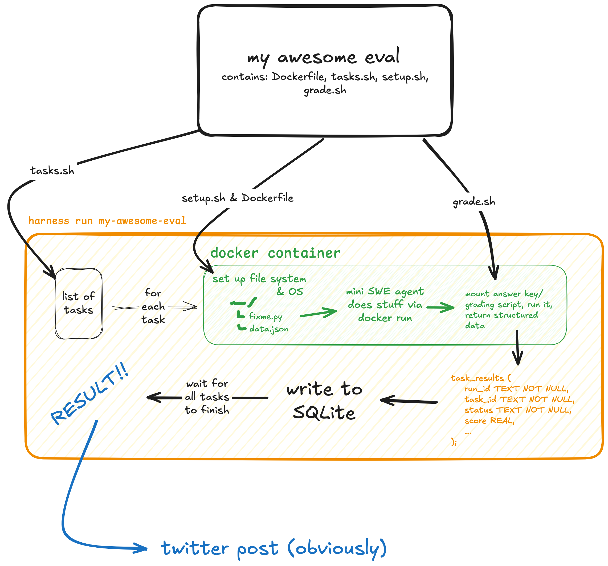

**A couple of additional notes**:
1. In reality, the "docker container" is three separate containers—this is to prevent the grading resources (scripts, answers, etc.) from being mounted inside the agent's container at any point.
2. "Write to SQLite" is more accurately "Update SQLite," since the first write actually happens right after the full lits of tasks is read. (This way concurrency can work: a task runner claims a row, runs the task, and then updates that row in SQLite).
3. `harness run` actually adds the run to the queue table in SQLite rather than just running it automatically. (But once the task is at the front of the queue this diagram shows how it would look).

Not pictured:
- Run queue (`harness run` writes to the queue database; `harness` runs until the queue is empty)
- Asynchronous workers (just runs multiple tasks at once up to an automatically-calculated resource limit)
- Crash recovery (`harness` can resume benchmark runs from the database)


# Agentic Harness Take-Home

A system for running AI agents against benchmark tasks.

## Usage

### Installation

```bash
make init       # Initialize git submodules (mini-swe-agent)
make install    # Install dependencies
source .venv/bin/activate
```

### Configuring mini-swe-agent

Run the setup wizard to configure your default model and API key:

```bash
mini-extra config setup
```

Read more about how to configure mini-swe-agent: https://mini-swe-agent.com/latest/usage/config/

### Run Examples

```bash
make bash-example
make py-example
```

These commands demonstrate the full workflow: setup → run agent → evaluate.

## Project Structure

```
.
├── benchmarks/
│   ├── bash-operations/      # Bash command benchmark
│   │   ├── harness/          # Adapter the harness calls (see note below)
│   │   │   ├── Dockerfile    # Image that every task container runs
│   │   │   ├── grade.sh      # Prints one task's score as JSON structured data
│   │   │   ├── setup.sh      # Fills one task's workspace with its starting files
│   │   │   └── tasks.sh      # Prints every task's ID and prompt as JSON
│   │   ├── dataset.json      # 5 bash tasks
│   │   ├── setup.py          # Setup workspace
│   │   ├── evaluate.py       # Evaluate results
│   │   └── README.md
│   └── python-tasks/         # Python coding benchmark
│       ├── harness/          # Same four files as bash-operations
│       ├── dataset.json      # 3 Python tasks
│       ├── prepare.py        # Setup workspace (different name!)
│       ├── grade.py          # Evaluate results (different name!)
│       └── README.md
├── agents/
│   ├── adapters/
│   │   └── mini-swe-agent/
│   │       └── run.sh        # Starts the agent on one task
│   └── mini-swe-agent/       # Example agent (git submodule)
├── examples/                 # Example scripts
├── src/
│   └── agentic_harness/      # Your harness implementation
└── Makefile
```

**NOTE**: We added a `harness/` folder to each benchmark and a `run.sh` adapter for the agent. The benchmarks' original files are unchanged. The harness only talks to a benchmark through the four files in its `harness/` folder. Adding a new benchmark means writing that folder, with no changes to `src/`.

- `Dockerfile` builds the image (`harness-<benchmark>`) that the setup, agent and grading containers all run. Docker builds it from the benchmark folder. That lets the Dockerfile copy files like python-tasks' `requirements.txt`. `harness run` builds the image once, before it queues the tasks.
- `tasks.sh` runs on the host. It prints a JSON list of `{"id", "prompt"}` objects. Each dataset names these fields differently: bash-operations uses `task_id` and `problem_statement`, while python-tasks uses `id` and `prompt`.
- `setup.sh <task_id>` runs in the setup container. It fills the task's empty workspace (`/workspace`) with its starting files.
- `grade.sh <task_id>` runs in the grading container after the agent finishes. It prints `{"passed", "score", "details"}` as JSON. python-tasks' version runs `prepare.py` again first to restore the original tests. That way an agent can't pass by editing them.
- `agents/adapters/<agent>/run.sh` starts the agent. The adapter lives outside `agents/mini-swe-agent/` because that folder is a git submodule. The harness hands it the task through environment variables: `HARNESS_PROMPT`, `HARNESS_IMAGE`, `HARNESS_WORKSPACE`, `HARNESS_OUTPUT_DIR`, `HARNESS_TIMEOUT_SECONDS` and `HARNESS_CONTAINER_LABEL`. `HARNESS_DOCKER_RUN_ARGS` holds the `docker run` flags for the agent's container as a JSON list, covering sandboxing, CPU and memory limits, the workspace mount and the cleanup label. Adapters pass these flags straight to their agent instead of writing their own. Whatever the agent leaves in the workspace is what gets graded.

The benchmark folder holds `setup.py`, the grader and the expected answers. Only the setup and grading containers can see it (read-only, at `/benchmark`). The agent's container only gets `/workspace`.

## Workflow

Each benchmark follows a three-step process:

1. **Setup**: Prepare workspace with initial files
2. **Execute**: Run agent to solve the task
3. **Evaluate**: Check if task was completed correctly

<hr>

The Notion requires that "Users can submit multiple benchmark runs without blocking;" I think this requirement decreases the value of the `harness`. Making run submissions non-blocking would (a) not work if many benchmarks are queued (my computer would start feeling memory strain at ~4 benchmarks queued) and (b) increase the time until the first useful results are given. I chose to make benchmark runs blocking but queuable; this means:
- all CPU & RAM is put into one benchmark at a time (this means you get results faster), and
- we avoid unnecessary complexity from having to distribute workers across multiple concurrent benchmarks.